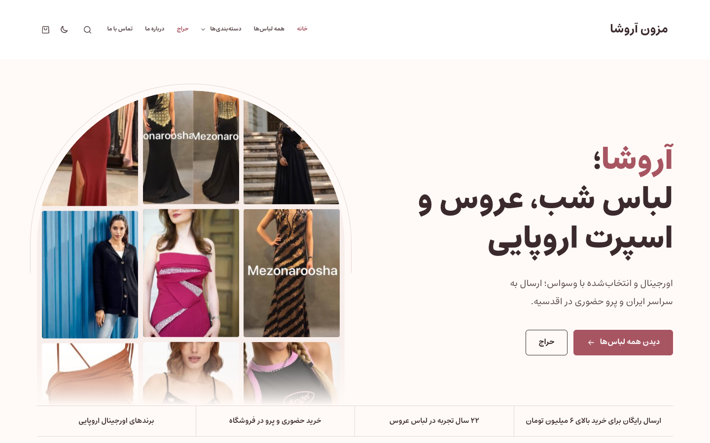
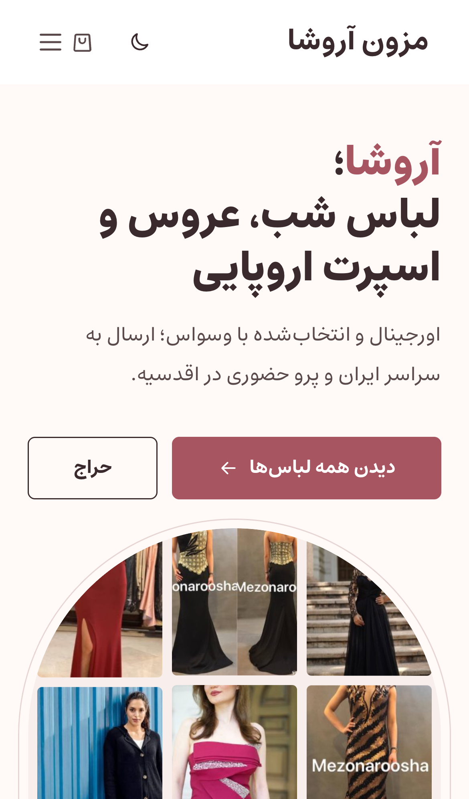
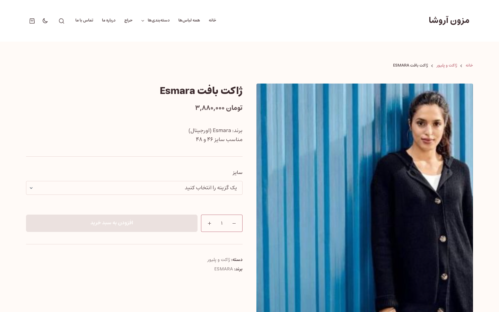
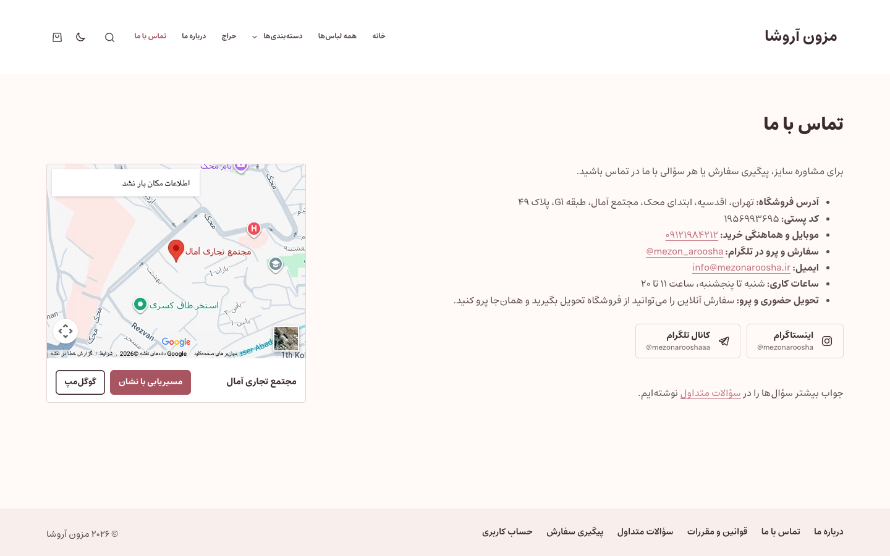
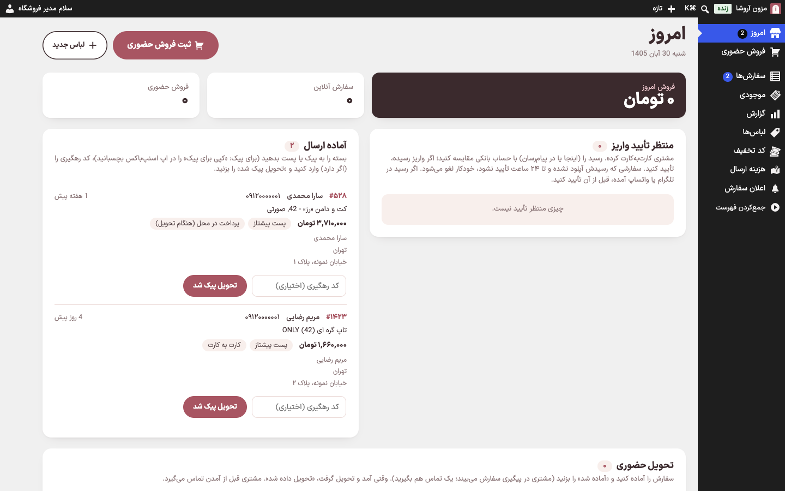
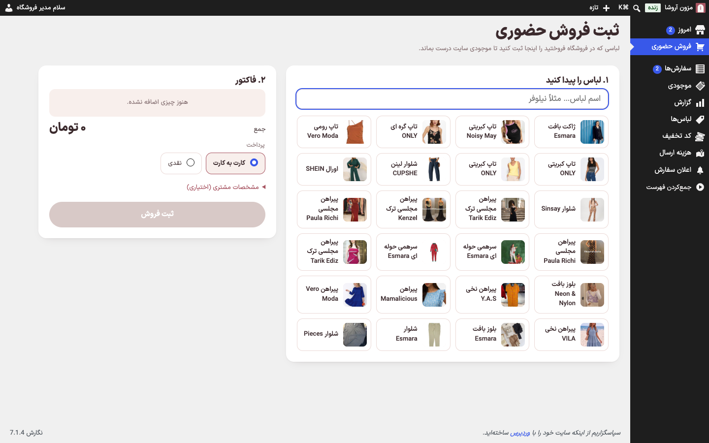
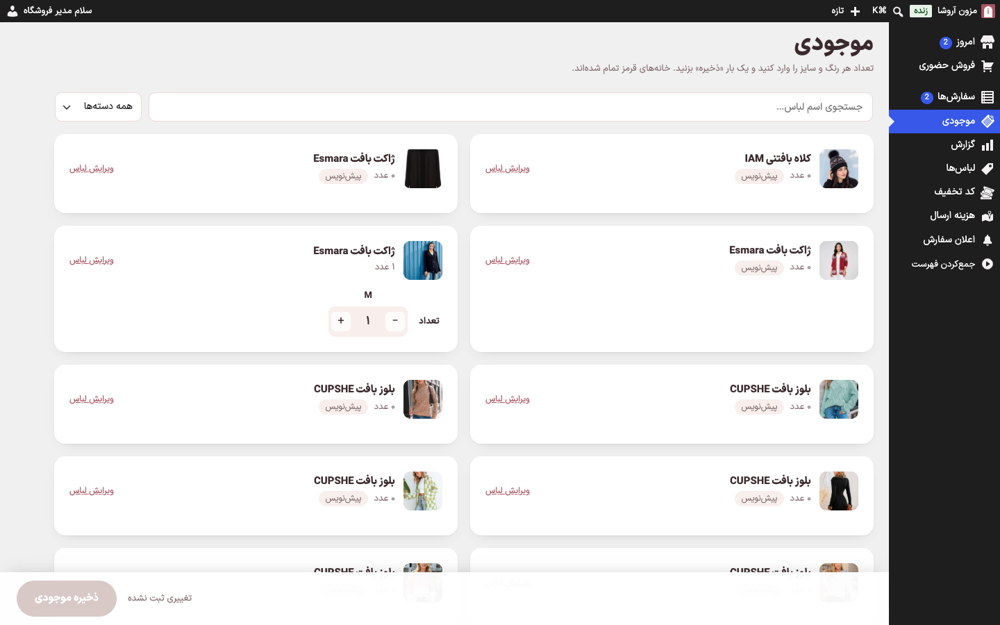
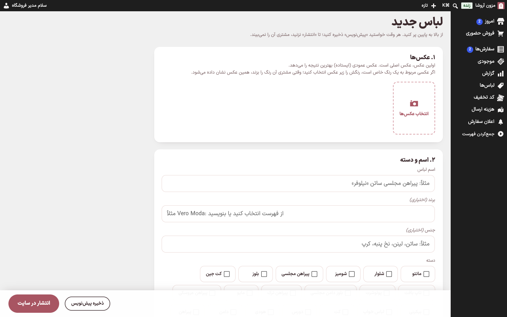
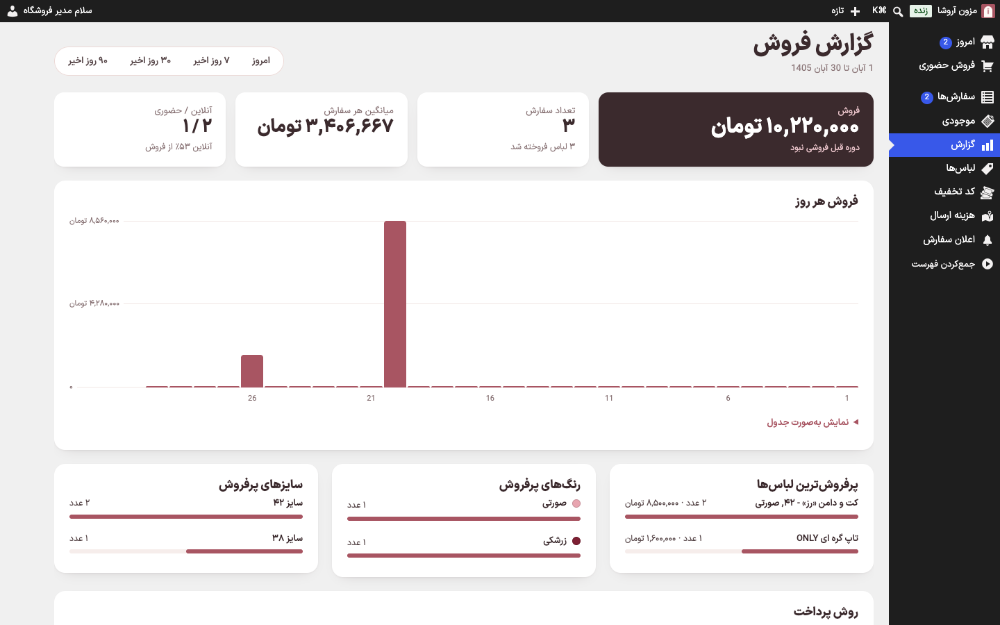
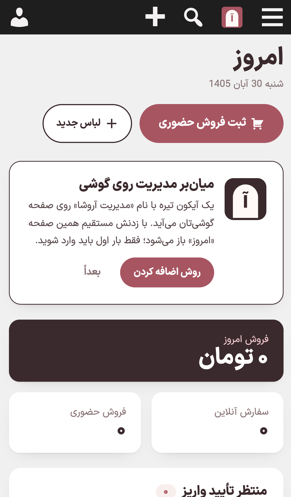

# Persian Boutique Shop: a ready-to-run WooCommerce store for Iran

A complete Persian (RTL) online shop on WordPress + WooCommerce, with a simplified admin built for a shop owner who isn't technical.

**It runs a real business.** This code is the live store of **[مزون آروشا](https://mezonaroosha.ir)**, a women's clothing boutique in Tehran that also sells in person. Customers order on it, and the owner runs it from her phone. Everything that makes it *that* shop (name, phone, address, card number, socials, wording) lives in **one config file**. Fork it, fill that file in, and you have a working e-commerce site for your own shop.

<p align="center">
  
  
</p>

## Why it's different

- **Works through Iran's internet cutoffs.** It makes no requests to Google Fonts, CDNs, Gravatar or any other foreign server. Fonts are self-hosted, and a test fails if any page calls an outside server. When the international internet goes down, the shop stays up.
- **An admin a non-technical owner can use.** The WordPress and WooCommerce complexity is hidden behind a few Persian screens:
  - «امروز»: today's orders
  - «فروش حضوری»: record an in-store sale
  - «موجودی»: stock grid
  - «لباس جدید»: add a product in one form
  - «گزارش»: sales report

  Unrelated menus, notices and upsells are removed.
- **Built for how Iranian shops actually sell:**
  - card-to-card payment with receipt upload
  - «استعلام قیمت» products (price on request via Telegram)
  - courier (پیک) inside your city, plus in-store pickup
  - order tracking by order number and mobile
  - order alerts to the owner in **Bale or Telegram**
- **Imports products from your Telegram channel.** It reads the channel's public posts and turns captions like `سایز: 38/40 قیمت: 1880T` into products with sizes, prices and photos.
- **Tested like a customer would use it.** About 20 Playwright suites place orders, upload receipts, change stock and apply coupons, then check the database.
- **Installable as an app.** Customers get a home-screen icon for the shop. The owner gets a separate dark «مدیریت» icon that opens straight to today's orders.
- **SEO without a plugin.** It covers titles, descriptions, link previews (Telegram and WhatsApp show the product photo), schema.org store, product and FAQ markup, a clean sitemap, and noindex rules.

## Screenshots

| Product page | Contact page |
|---|---|
|  |  |

**The owner's side** is in Persian, simplified, and works on a phone. Customer names in these shots are made up.

| «امروز»: today's orders | «فروش حضوری»: in-store sale |
|---|---|
|  |  |
| **«موجودی»: stock grid** | **«لباس جدید»: add a product** |
|  |  |
| **«گزارش»: sales report** | **On the owner's phone** |
|  |  |

## Quick start

You need Docker and Node.js.

```sh
git clone <your fork> shop && cd shop
cp config/shop.example.php config/shop.php      # then fill in your shop's details
docker compose up -d
docker compose --profile cli run --rm --entrypoint sh wpcli /scripts/setup.sh   # first time (safe to re-run)
```

| | URL | Login |
|---|---|---|
| Shop | http://localhost:8080 | |
| Admin | http://localhost:8080/wp-admin | `admin` / `admin_local_pw` |
| Shop manager (the owner's view) | http://localhost:8080/wp-admin | `manager` / `manager_local_pw`, opens on «امروز» |

These passwords are for local use only.

Setup installs WordPress (fa_IR), WooCommerce, Persian WooCommerce and Blocksy. It then creates the categories, sizes, colors, shipping zones, pages, menus and placeholder products.

To wipe everything and start over, run `docker compose --profile cli down -v`, then the two commands above.

## Make it your shop

### 1. `config/shop.php`: your details in one file

```php
return [
    'name'             => 'فروشگاه شما',
    'phone'            => '09120000000',
    'telegram_order'   => 'your_shop',
    'telegram_channel' => 'your_channel',
    'instagram'        => 'your_shop',
    'address'          => 'تهران، خیابان …',
    'card_number'      => '6037-…',
    'hero_title'       => 'لباس مجلسی و اسپرت',
    // … config/shop.example.php lists every key, each with a comment
];
```

Everything reads from this file: the theme, the admin plugin, the setup scripts, emails, app manifests, search-engine markup and the tests. Keys you leave out fall back to the example. The file is **gitignored**, so your phone and card number never reach GitHub.

| Group | Keys |
|---|---|
| Identity | `name`, `name_latin`, `short_name`, `description`, `email` |
| Contact | `phone`, `whatsapp`, `telegram_order`, `telegram_channel`, `instagram`, `bale` |
| Physical shop | `address`, `street`, `city`, `state_code`, `postcode`, `hours`, `open_days`, `open_hours`, `map_label`, `map_query`, `map_url` |
| Payment | `card_number`, `card_holder` |
| Delivery and alerts | `courier_city`, `notify_phones` |
| Words on the site | `hero_title`, `hero_lede`, `visit_title`, `seo_tagline`, `seo_home`, `seo_shop`, `about`, `faq_brands` |
| Look | `colors.theme`, `colors.background`, `colors.admin_theme` |

Most changes show up on the next page load. The seeded pages (about, contact, FAQ intro, terms) update when you re-run setup.

### 2. Your logo

Replace these PNGs with your own, keeping the same file names and sizes:

- `theme/blocksy-child/brand/`: favicon, site icon, social profile pictures
- `theme/blocksy-child/app/`: customer home-screen icons (maskable = logo at 80% size)
- `plugins/boutique-admin/assets/app/`: the owner's dark admin icon

### 3. Your products

Add products by hand in «لباس جدید», or import them from your Telegram channel:

```sh
python3 scripts/import/telegram_fetch.py --count 40     # reads t.me/s/<telegram_channel> → products.json + photos/
docker compose --profile cli run --rm wpcli eval-file /scripts/import/import-products.php            # add/update
docker compose --profile cli run --rm wpcli eval-file /scripts/import/import-products.php replace    # also removes placeholders
```

How the importer handles posts:

- It reads the name, brand, sizes and price from each caption (`1880T` = 1,880,000 toman). Stock is set to 1 per listed size.
- Posts the parser is unsure about become **drafts**. The problem and the original caption go in the description.
- Posts with no price become «استعلام قیمت»: they can't be bought online and show Telegram and phone buttons instead.
- Re-running updates the same products, matched by post number.

The category rules and brand spellings at the top of `telegram_fetch.py` are tuned for clothing. Adjust them for what you sell.

### 4. Settings the owner changes in the admin

The owner manages these from the admin, with no code:

- shipping prices in «هزینه ارسال»
- discount codes in «کد تخفیف»
- Bale/Telegram order alerts in «اعلان سفارش»

The size guide table is in `theme/blocksy-child/functions.php`.

## Tests

These are end-to-end browser tests. They use the site as a customer and as the shop manager, then check the database.

```sh
npm install        # once
npm test           # with the site running (docker compose up -d)
```

- The tests create their own product («لباس تست خودکار») and delete it, with its orders, afterwards.
- They read your `config/shop.php`, so they pass with your details too.
- If Playwright's browser download is blocked, they use a Chromium already on the machine. Set `PW_CHROME=/path/to/chrome` to pick one.
- To test another copy: `COMPOSE_PROJECT_NAME=x SITE_PORT=8081 SITE_URL=http://localhost:8081 npm test`.
- To check a live site: `LIVE_URL=https://your-shop.ir LIVE_ADMIN_PASS=… LIVE_MANAGER_PASS=… npx playwright test -c tests/live/playwright.live.config.js`. One of these tests places a real order, then cancels and deletes it.

Run the tests before every deploy and after every WordPress, WooCommerce or plugin update.

| Suite | Covers |
|---|---|
| `01-storefront` | Home sections, sale %, menu, product page (color photos, sold-out size, size guide), **no external requests**, no sideways scroll on phones |
| `02-checkout` | Guest checkout with card-to-card, required mobile number, stock reserved |
| `03-admin-access` | Manager lands on «امروز», trimmed menu, blocked pages, no external requests in admin |
| `04-today` | Confirm payment → ship with a tracking code; cancelling restores stock |
| `05-instore` | An in-store sale at a negotiated price lowers stock |
| `06-stock` | Stock grid: Persian digits, + button, one save |
| `07-product-form` | One-page product form: validation, colors, photo → color, drafts |
| `08-reports` | Only confirmed orders count; chart ranges; desktop and phone |
| `09-coupons` | Minimum cart, usage limit, used-up codes |
| `10-shipping` | The owner changes or disables a delivery price, and the cart reflects it |
| `11-tracking` | Every tracking state; never shows the address; rate limit |
| `12-ask-price` | «استعلام قیمت» products can't be bought, even by URL |
| `13-delivery` | Courier only inside your city; GPS or map link saved; pickup flow |
| `14-seo` | Titles, descriptions, previews, store/product/FAQ schema, sitemap, robots.txt |
| `15-receipts` | Card details after ordering; receipt upload (non-images refused, file not public) |
| `16`–`20` | Free shipping, Bale/Telegram alerts, customer emails, order lists, home-screen app |

## How it's built

| Path | What |
|---|---|
| `config/` | `shop.example.php` (committed) and your `shop.php` (gitignored) |
| `theme/blocksy-child/` | Child theme of [Blocksy](https://creativethemes.com/blocksy/): RTL, self-hosted Estedad font (digits drawn in Persian), home sections as shortcodes, SEO, FAQ, dark mode, customer app |
| `plugins/boutique-admin/` | The owner's admin: «امروز», «فروش حضوری», «موجودی», «لباس جدید», «گزارش», coupons, shipping, receipts, delivery rules, Bale/Telegram alerts, emails. `inc/shop.php` loads the config |
| `scripts/` | `setup.sh` (full install); `store.php`, `delivery.php`, `pages.php`, `theme.php` (seeding); `import/` (Telegram importer); `deploy/prod-clean.php`; `screenshots.js` (regenerates the images above) |
| `tests/` | Playwright suites (`tests/live/` checks the production site) |
| `docker/` | Local images (adds `pdo_mysql`, which Persian WooCommerce needs) |

**Delivery.** The courier (پیک) is offered only inside `courier_city`, and the customer pays the rider on delivery. Customers can share a GPS location or a Neshan, Balad or Google Maps link. The owner gets «نشان» and «کپی برای پیک» buttons. In-store pickup is offered everywhere and goes «آماده شد» → «تحویل داده شد».

**Payments.** With card-to-card, the customer sees the card number and amount after ordering. They then upload the receipt or send it on Telegram, WhatsApp or Bale. Receipts are kept out of public reach (`uploads/boutique-receipts/`, blocked by `.htaccess`). Unpaid orders cancel themselves after 24 hours and their stock is released. A bank gateway can be added once you have eNamad.

## Deploying

Any Iranian host works if it has PHP 8.1+ with `pdo_mysql`, MySQL or MariaDB, and Apache or LiteSpeed (for `.htaccess`).

1. Install WordPress, WooCommerce, Persian WooCommerce and Blocksy on the host, or upload a copy of your local site.
2. Upload `theme/blocksy-child/` to `wp-content/themes/` and `plugins/boutique-admin/` to `wp-content/plugins/`.
3. Upload `config/` as **`wp-content/shop-config/`**, so your file ends up at `wp-content/shop-config/shop.php`.
4. If you're uploading a copy of your local database, first run `scripts/deploy/prod-clean.php` on it to strip test orders, coupons and demo data. Then replace the URLs with `wp search-replace`.
5. In `wp-config.php`: turn debug off, set `DISALLOW_FILE_EDIT`, and use a real cron (`DISABLE_WP_CRON` plus `*/5 * * * * php wp-cron.php`).

No SSH is needed. The live shop was deployed over FTPS, with a temporary cPanel cron job for the server-side steps.

## License

The code is under the MIT license (see `LICENSE`). The Estedad font is under the SIL Open Font License (`theme/blocksy-child/fonts/OFL.txt`). The shop's name, logo and product photos belong to مزون آروشا and are not covered by the license.
